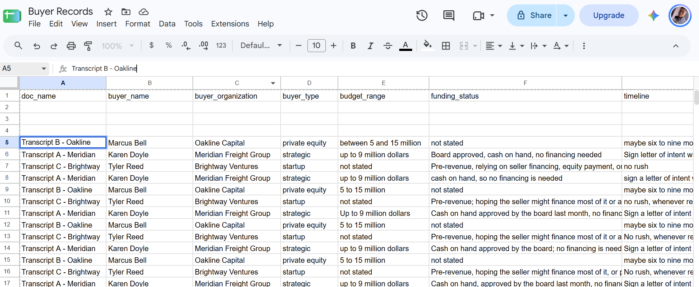
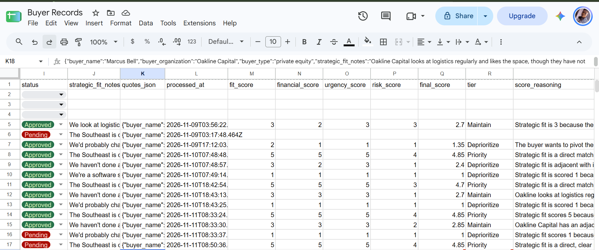
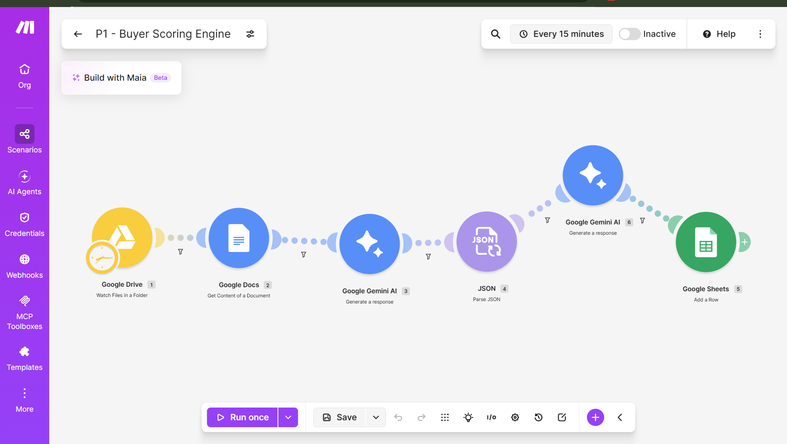
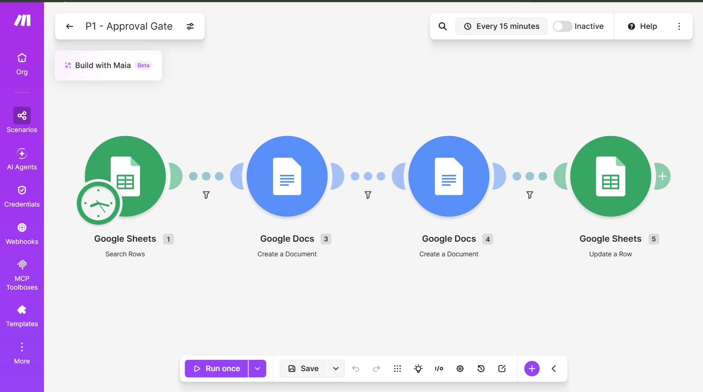

# Buyer Scoring Engine

**Problem:** Sales call transcripts are slow to review by hand, so strong buyers get missed and weak ones eat time.

**Tools used:** Make, Google Gemini, Google Sheets, Google Docs

**How it works:**
- Workflow 1 (Scoring): a call transcript comes in, AI extracts the key buyer details and scores the buyer
- Workflow 2 (Approval gate): a human reviews the score and approves or rejects it before anything is sent
- Output: a scorecard and a briefing doc, with a link to both

**Result:** Tested on 6 call transcripts, and the scores matched the answer key on 5.

**Result 1: Scoring sheet**

**Result 2: Scorecard**

**Workflow 1: Scoring**
Each transcript is read by AI, which pulls out the buyer details and scores the buyer. The results are logged in Google Sheets.

**Workflow 2: Approval gate**
Nothing goes out until a person approves the score. An approved buyer gets a scorecard and a briefing doc, and the link to both is returned.

