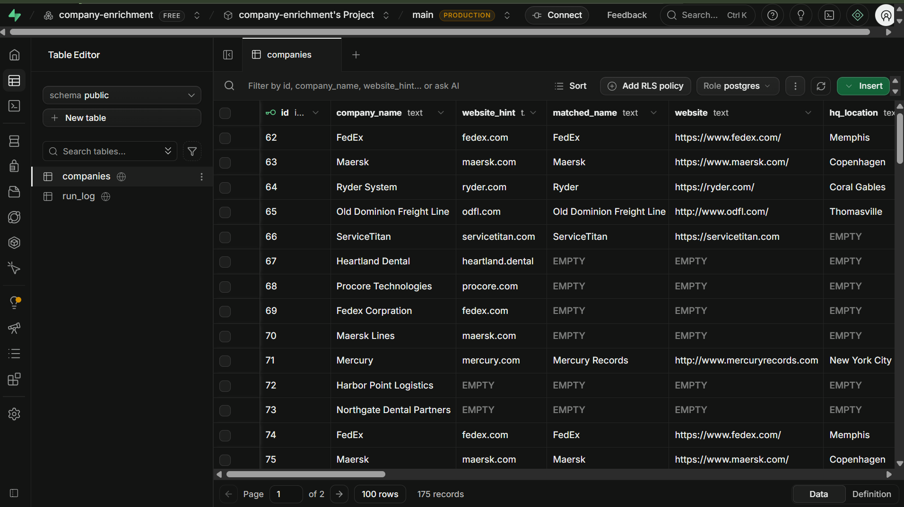
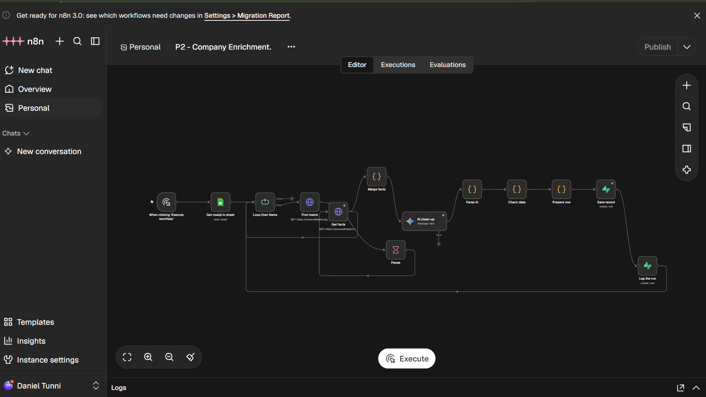

# Company Enrichment Pipeline

**Problem:** Company lists arrive incomplete and messy, so teams spend hours researching each company by hand and still end up with inconsistent records.

**Tools used:** n8n, Wikidata, Google Gemini, Supabase

**How it works:**
- Input: a list of company names
- Each company is looked up automatically and the data is cleaned and standardised
- AI fills in missing details
- Records that look unreliable are flagged for human review
- Output: clean, enriched company records stored in a database

**Result:** Ran end to end on 12 test companies; of 12 matched the expected answers.

**Result 1: Enriched database**

**Workflow**

