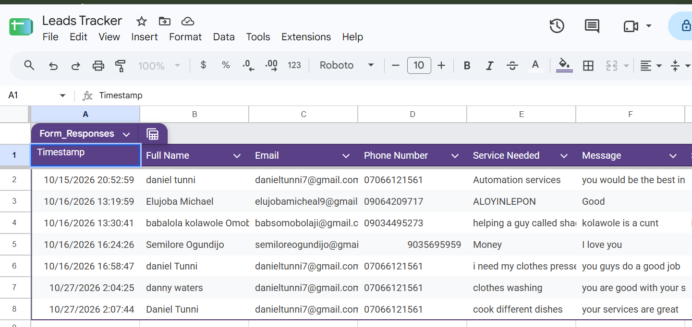
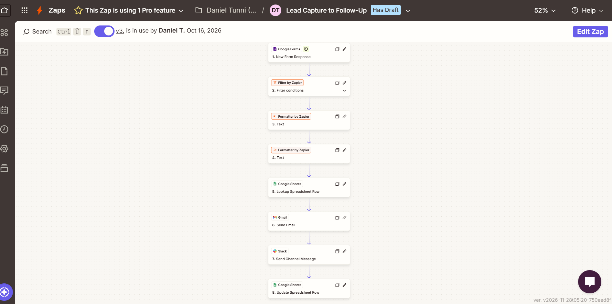

# Lead Capture and Follow-Up Automation

**Problem:** Business enquiries from a web form sit unanswered because nobody checks the form straight away.

**Tools used:** Zapier, Google Forms, Google Sheets, Gmail, Slack

**How it works:**
- Trigger: a customer submits the enquiry form
- Action: the lead is saved in Google Sheets, the customer gets a personalised confirmation email, and the business owner gets an instant Slack alert
- Result: every enquiry is logged, acknowledged and flagged to the owner automatically

**Result:** Tested with sample form entries: each one was logged in the sheet, the customer received a personalised confirmation email and the owner received a Slack alert, with no manual steps.

**Result 1: Output**

**Workflow**

